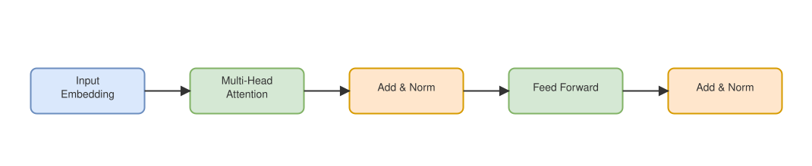
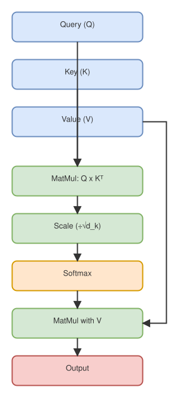

Placeholder post to exercise the diagram pipeline: `.drawio.svg` figures at
two different widths, cross-references, and a display-math block. None of
the prose below is meant to be technically complete — real content comes
later.

## The architecture, end to end

@fig-architecture lays out the block-level flow through a single transformer
encoder layer. It's wide enough that it needs the full page width to stay
readable, so it breaks out of the text column via `.column-page`:

::: {.column-page}
{#fig-architecture}
:::

## Zooming into one block

Within the "Multi-Head Attention" block above, each head runs the same
scaled dot-product computation, shown in @fig-sdpa. This one is narrow and
tall, so it's kept at the default column width instead of stretched:

{#fig-sdpa}

For a single head, attention weights are computed as

$$
\text{Attention}(Q, K, V) = \text{softmax}\!\left(\frac{QK^\top}{\sqrt{d_k}}\right)V
$$

where $Q$, $K$, and $V$ are the query, key, and value matrices for that
head, and $d_k$ is the key dimension — the scaling term that keeps the
softmax from saturating as $d_k$ grows.

Both figures above are numbered automatically: @fig-architecture and
@fig-sdpa resolve to real figure numbers, not literal `@fig-` text. Click
either one to open it full-size in the lightbox.

## Sizing options

Diagram source canvases are never a standard size, and they shouldn't need
to be — Quarto's column layout covers the range from "pin it down exactly"
to "let it use the whole screen". The same `.drawio.svg` renders fine at any
of these:

**Explicit width**, useful when a diagram reads best at a fixed size
regardless of column width:

```md
{#fig-sdpa-explicit width=450}
```

{#fig-sdpa-explicit width=450}

**Edge-to-edge**, for a diagram wide enough that even the full page column
feels cramped:

```md
::: {.column-screen-inset}
{#fig-architecture-inset}
:::
```

::: {.column-screen-inset}
{#fig-architecture-inset}
:::

@fig-sdpa-explicit and @fig-architecture-inset are the same two diagrams
used above — only the sizing directive changes. See the README for the
full set of copy-pasteable snippets, including the plain default-width form.
