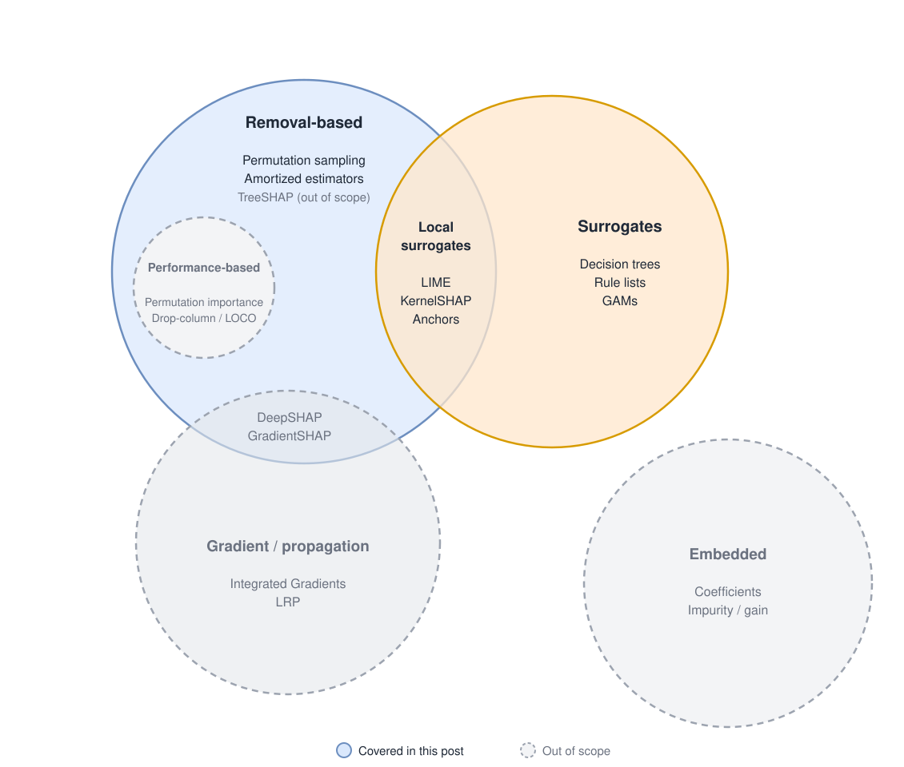
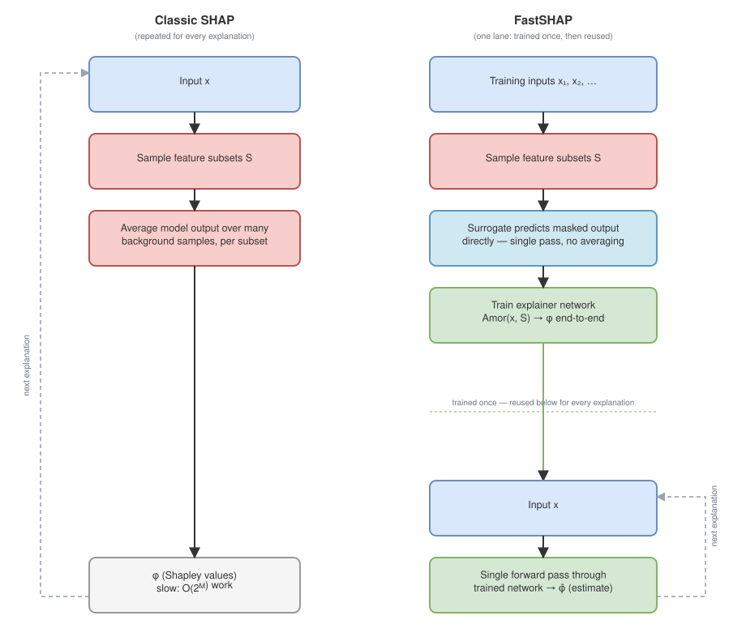

## Introduction

Most models that end up in production raise two questions. Why did the model make this particular prediction? Which features actually matter, and which just add noise? Stakeholders want to know why the model reached a given conclusion, and whether the features behind it match their understanding of the domain. The team building the model needs to know which features earn their place, both to guide feature engineering and to debug unexpected behaviour.

Some models answer this out of the box. In linear models, it's the coefficients: with normalised features and some regularisation (or a Bayesian prior), each one roughly tells you how much its feature moves the prediction. High-performance non-linear models like boosted trees report importance scores too, but these are heuristic summaries with well-known biases, and neural networks don't offer one at all.

A useful explanation needs more than just a ranking. It should say which way a feature moved the prediction: "low income raised the risk" is an explanation, while "income matters" isn't. It should measure every contribution on the scale of the prediction itself, so you can compare one feature against another, or one model against the next. And it should be model-agnostic, treating the model as a black box, so the same method works for tree ensembles and neural networks alike.

Model-agnostic methods meet these requirements to different degrees. Permutation importance is simple and cheap, but it only gives a global ranking, with no direction and no explanation of individual predictions. LIME explains individual predictions with signed weights, but these are only a local approximation and don't add up to the prediction. Shapley values meet every requirement and add guarantees on top: contributions sum exactly to the prediction, and a feature can't get less credit when the model relies on it more. That rigour comes at a price, and it's where the real challenges begin.

The first challenge is scale. Computing a Shapley value means evaluating the model on every possible combination of features, and the number of combinations grows exponentially. Past a few dozen features, exact values are intractable. Sampling-based approximations help, but a single explanation can still take thousands of model calls.

The second challenge is correlation. When several features carry the same signal, they compete for the credit. The importance gets split between them, sometimes evenly, sometimes arbitrarily, so each one looks weaker than the signal it represents, and small changes to the data or the model can reshuffle the split. Correlation also undermines the estimation itself. Numerically, "removing" a feature usually means sampling it from its marginal distribution, which ignores the correlation structure and creates inputs that are unrealistic or outright impossible: dozens of transactions with almost no money spent, or more transactions in the past hour than in the past day. The model's predictions on such inputs are meaningless, yet they feed straight into the explanation.

Neither problem has a free fix, but both have good partial answers. The rest of this post looks at what they are, and what each one costs.

## Where feature-importance methods live

Feature-importance methods fall into a few overlapping families
(@fig-taxonomy). This post covers removal-based methods and global
surrogates.

**Removal-based methods** remove features and measure how the model's output, or its error, changes. When the target is the Shapley value, it has to be estimated: permutation-sampling estimators (Štrumbelj & Kononenko) average a feature's contribution over random feature orderings, and amortized estimators train a separate model to output the estimates directly.

**Surrogate methods** fit an interpretable model that mimics the black box: globally, as a decision tree, rule list or GAM, or locally, around a single prediction.

The two families overlap in local surrogates. LIME and KernelSHAP both perturb the input around one prediction and fit a weighted linear model, differing mainly in the weighting kernel and regularisation; Anchors instead searches for an if-then rule that keeps the prediction unchanged.

Out of scope:

- **Embedded methods** read importance from the model's own structure or training (linear coefficients, tree gain), so they only exist for one model family.
- **Gradient- and propagation-based methods** (Integrated Gradients, LRP) need access to a neural network's internals, its gradients or layers. DeepSHAP and GradientSHAP sit between this family and removal-based methods: they remove features against a background distribution, but compute contributions by propagating through the network.
- **TreeSHAP** is removal-based and computes Shapley values exactly for tree ensembles, but it relies on tree structure and works for nothing else.
- **Performance-based methods** (permutation importance, drop-column) are the subset of removal-based methods that measure how much the model's error grows without a feature. They need true labels, give only a global ranking with no direction, and both mishandle interactions and correlations. Permutation importance credits an interaction in full to every feature involved and can inflate correlated features by scoring the model on unrealistic inputs. Drop-column retrains once per feature, pushes correlated features towards zero, and misses effects that only appear when features are removed together.

{#fig-taxonomy}

## Shapley values, and why exact SHAP doesn't scale

SHAP values are simultaneously an approximation of the classic Shapley
value from cooperative game theory and a generalization of several other
attribution methods, including LIME [@lundberg2017]. For a fixed sample
$x$, the Shapley value for feature $i$ averages that feature's marginal
contribution across every possible subset of the other features:

$$
\varphi_i = \sum_{S \subseteq F \setminus \{i\}} \frac{|S|!\,(|F|-|S|-1)!}{|F|!}
\Big[ f_{S \cup \{i\}}(x_{S \cup \{i\}}) - f_S(x_S) \Big]
$$

In words: look at every permutation of features, with and without feature
$i$, and average how much adding it changes the prediction. That sum has
$2^{|F|-1}$ terms — exponential in the number of features — and in its
purest form requires retraining the model on every feature subset. With
200+ features, this is not "slow," it's simply not computable.

Sampling-based estimators avoid retraining by Monte Carlo sampling
permutations instead of enumerating them, and by *integrating out* missing
features (averaging the prediction over background samples) instead of
retraining without them [@aas2021]. This is what makes SHAP practical at
all — but it's still fundamentally doing many model evaluations per sample,
and it is known to become unreliable when features are substantially
correlated. Faster SHAP variants exist — model-agnostic Kernel SHAP and
model-specific Tree SHAP — but they trade one cost for another: Tree SHAP
avoids the sampling problem via recursive tree traversal, at a memory cost
of $O(TD^2 + TN)$ for an ensemble of $T$ trees of average depth $D$ with $N$
total tree nodes [@lundberg2018]. For a large ensemble, that adds up fast.

## Cutting the per-sample cost: FastSHAP

The most efficient class of methods sidesteps per-sample computation
entirely by *amortizing* it: train a parametric function once, up front,
that maps any input directly to its Shapley values in a single forward
pass. The current state of the art here is **FastSHAP** [@jethani2021].

::: {.column-page}
{#fig-fastshap}
:::

@fig-fastshap shows the shift. FastSHAP trains two surrogates instead of
running Monte Carlo sampling per sample:

1. **A surrogate for the value function itself.** Rather than solving a
   separate optimization problem per feature per sample, it learns the
   Shapley value function across many training points at once, using
   similar samples to interpolate and extrapolate — an explicit sample-
   efficiency trade.
2. **A surrogate for "what happens with missing features."** Instead of
   averaging the prediction over many background samples per subset (the
   expensive part of classic SHAP), it needs a single prediction per
   evaluation. The explanation it produces reflects the model's
   *information* dependence on a feature rather than its raw algebraic
   dependence.

The catch: once trained, FastSHAP can't guarantee accuracy for any single
feature the way a heavy Monte Carlo estimate can. It's a real trade of
per-feature guarantees for tractability.

## Paying for accuracy only where it's needed: Selective Explanations

**Selective Explanations** [@paes2024] is a hybrid: use the fast amortized
estimate where it's already trustworthy, and fall back to the slow but
accurate Monte Carlo estimate everywhere else.

$$
\text{SE}(x, y) \;\triangleq\;
\begin{cases}
\text{Amor}(x, y) & \text{if } \tau_\alpha(x) = 1, \\[4pt]
\lambda_h(x)\,\text{Amor}(x, y) + \big(1 - \lambda_h(x)\big)\,\text{MC}^n(x, y) & \text{if } \tau_\alpha(x) = 0,
\end{cases}
$$

where $\tau_\alpha$ is a threshold on an *uncertainty* measure and
$\lambda_h$ is a feature-specific blending weight. Two ways of defining
that uncertainty are proposed:

**Deep uncertainty** — train several amortized networks with different
random seeds and treat their disagreement as the uncertainty signal:

$$
s_h^{\text{Deep}}(x) \;\triangleq\; \frac{1}{dk}\sum_{i=1}^{d}
\mathrm{Var}\Big(\text{Amor}^1(x)_i, \dots, \text{Amor}^k(x)_i\Big)
$$

**Learned uncertainty** — instead of an ensemble, train a function to
directly predict the expected gap between the amortized and Monte Carlo
estimates:

$$
s_h^{\text{Learn}} \in \operatorname*{argmin}_{s \in \mathcal{F}}
\sum_{(x,y) \in \mathcal{D}_{\text{train}}}
\big| s(x) - \ell\big(\text{Amor}(x;y), \text{MC}^n(x;y)\big) \big|^2
$$

This is the most intricate of the methods here — it needs both an
uncertainty estimator and a calibrated threshold — but it's the only one
that explicitly spends the expensive computation only where the cheap one
is already known to be untrustworthy.

## The multicollinearity problem

None of the above fixes the second problem: when features are highly
correlated — our velocity features being the clearest example — their
joint contribution to a prediction gets *split* across all of them by the
Shapley averaging process. Each individual value ends up small and close
to arbitrary, even though the group of features clearly matters. There are
two genuinely different ways to respond to this.

### Option A: decorrelate, then attribute per feature

@basu2020 proposes removing the correlated component from every *other*
feature before estimating a given feature's importance. To remove feature
$j$'s component from feature $k$,
solve for a correction term $AF_k$ that makes the two uncorrelated:

$$
\operatorname{cor}(X_j, X_k + AF_k) = 0
\quad\Longrightarrow\quad
AF_k = -\frac{\operatorname{cov}(X_j, X_k)}{\operatorname{var}(X_j)} X_j
$$

The same idea extends to decorrelating from two features $X_i, X_j$ at
once:

$$
a = \frac{\operatorname{cov}(X_i,X_k)\operatorname{var}(X_j) - \operatorname{cov}(X_j,X_k)\operatorname{cov}(X_i,X_j)}
{\operatorname{var}(X_i)\operatorname{var}(X_j) - \operatorname{cov}(X_i,X_j)^2},
\qquad
b = \frac{\operatorname{cov}(X_j,X_k)\operatorname{var}(X_i) - \operatorname{cov}(X_i,X_k)\operatorname{cov}(X_i,X_j)}
{\operatorname{var}(X_i)\operatorname{var}(X_j) - \operatorname{cov}(X_i,X_j)^2}
$$

with $AF_k = aX_i + bX_j$. The trade-off is that the resulting values lose
the *additivity* property — correlated features no longer cleanly split
predictive credit between each other — in exchange for values that don't
bounce around randomly among correlated features from run to run. It also
gives us a diagnostic for free: comparing a pair of features' corrected
marginal importances against their corrected *joint* importance tells us
how independent they really are —

$$
\frac{\text{Multcol\_}\varphi(A) + \text{Multcol\_}\varphi(B)}{\text{Multcol\_}\varphi(A,B)}
$$

— a ratio of 1 means fully independent; the further from 1, the more
correlated.

### Option B: don't split the credit at all

**groupShapley** [@jullum2021] takes the opposite approach: instead of
correcting individual features, compute Shapley values for *groups* of
features directly, by applying the same game-theoretic formula to groups
instead of single features:

$$
\varphi_{\mathcal{G}_i} = \sum_{\mathcal{T} \subseteq \mathcal{G} \setminus \mathcal{G}_i}
\frac{|\mathcal{T}|_g!\,(G - |\mathcal{T}|_g - 1)!}{G!}
\Big(v(\mathcal{T} \cup \mathcal{G}_i) - v(\mathcal{T})\Big)
$$

where $\mathcal{G} = \{\mathcal{G}_1, \dots, \mathcal{G}_G\}$ is a
partition of the features into $G$ groups. Because this is still exactly
the Shapley framework — just applied to groups instead of individual
features — it keeps every one of the usual guarantees (efficiency,
symmetry, the null-player property) that Option A gives up. It's also
dramatically cheaper: complexity drops from $2^{|F|-1}$ to $2^{G-1}$. With
50 features collapsed into 5 groups, that's a reduction factor over
$10^{13}$.

::: {.column-page}
{#fig-groupshapley}
:::

@fig-groupshapley shows the contrast for our velocity features
specifically. Groups can be built two ways: by *practical* meaning (e.g.
all velocity features as one group, all entity-history features as
another) or by *statistical dependence* (cluster whatever is actually
correlated, whether or not it shares a name). For our case, the natural
first cut is the practical one — group the velocity family together — with
dependence-based grouping as a refinement if any group still turns out to
mix loosely related features.

Options A and B aren't mutually exclusive, and they answer different
questions. groupShapley tells us whether the *velocity family as a whole*
matters, cheaply and with all of Shapley's usual guarantees, but not which
window (1h vs. 24h vs. 7d) is carrying that signal. The AF-correction
approach can still tell us that — at the cost of the additivity property
and a more involved implementation, since off-the-shelf FastSHAP isn't
built to decorrelate before attributing. In practice, groupShapley is the
cheaper first thing to try; individual-feature decorrelation only if a
group turns out to matter and we need to know which member drives it.

## A different lever: surrogate models

Every method above stays inside the Shapley framework. A structurally
different option is to train a simpler, more interpretable model that
mimics the black-box one closely enough to *stand in* for it — most
commonly a decision tree. **Genetic decision trees** [@kennedy2022] make
this more viable than a single greedily-grown tree: a population of
candidate trees is generated with bootstrap sampling, then evolved by
mutating and combining the strongest candidates over several rounds
instead of growing one tree greedily start-to-finish. The result is a
single tree that's denser and more stable while staying close in
performance to the original ensemble. It's a fundamentally different kind
of explanation — a whole visualizable decision path instead of a
per-feature number — worth keeping in mind as a complement to
Shapley-based methods, not a replacement.

(Worth flagging: the source notes for this post linked "Genetic Decision
Trees" to arXiv:1904.12847, but that paper is actually *Optimal Sparse
Decision Trees* [@hu2019] — a different, dynamic-programming-based method
for building small trees, not the bootstrapped/evolved approach described
above. The bootstrapped-and-mutated technique matches @kennedy2022
instead, which isn't a formal paper — worth keeping in mind if this needs
a peer-reviewed citation later.)

## Where this leaves us

FastSHAP is the easiest of these to adopt now — the library applies to our
data with relatively little friction. groupShapley is nearly as cheap: it
only requires deciding on a grouping, not touching FastSHAP's internals.
Combining FastSHAP *with* per-feature multicollinearity correction is more
involved, since the correction changes what each surrogate needs to learn.
Selective Explanations is the most work of all — it needs both an
uncertainty estimator and calibrated thresholds — but it's also the only
approach here that spends the expensive computation only where it's
actually earned.

## References

::: {#refs}
:::
