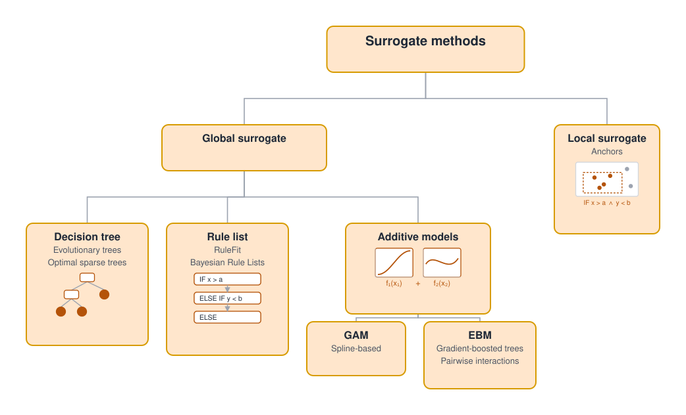
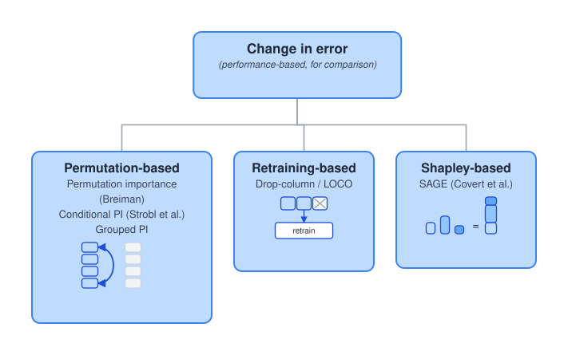
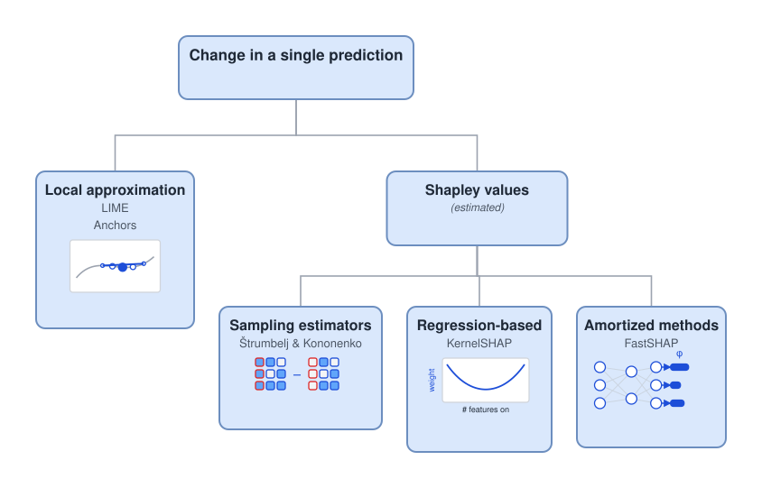
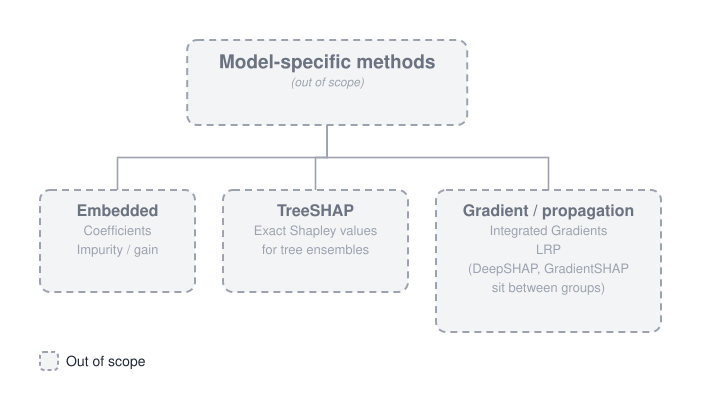
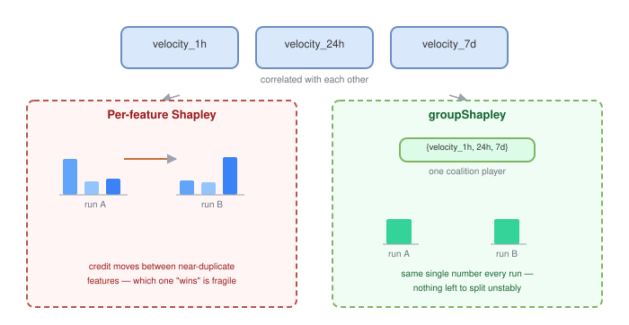

## Introduction

Most models that end up in production raise two questions. Why did the model make this particular prediction? Which features actually matter, and which just add noise? Stakeholders want to know whether the features behind a prediction match their understanding of the domain. The team building the model needs to know which features earn their place, both to guide feature engineering and to debug unexpected behaviour.

For some models, the answer comes built-in. With normalised features and some regularisation (or a Bayesian prior), coefficient in a linear model roughly tell you by how much its feature moves the prediction. High-performance non-linear models are by far less transparent. Boosted trees provide importance scores, but these are heuristic summaries with well-known biases, while neural networks have no built-in equivalent at all.

A useful explanation needs more than just ranking. It should point at direction feature moves the prediction: “low income raised the risk” is an explanation, while “income matters” isn’t. It should measure every contribution on the scale of the prediction itself, so you can compare one feature against another, or one model against the next. And it should be model-agnostic, treating the model as a black box, so the same method works for tree ensembles and neural networks alike.

Model-agnostic methods meet these requirements to varying degree. Permutation importance is simple and cheap, yet it only gives a global ranking, with no direction and no explanation of individual predictions. LIME explains individual predictions with signed coefficients, but these are only local approximations and don't add up to the prediction. Shapley values meet every requirement and add guarantees on top: contributions sum exactly to the gap between the prediction and the average prediction, and they are consistent, so a feature’s Shapley value never decreases when its contribution to the model increases.That rigour comes at a price, and it's where the real challenges begin.

The first challenge is scale. Computing a Shapley value means evaluating the model on every possible combination of features, and the number of combinations grows exponentially. Past a few dozen features, exact values are intractable. Sampling-based approximations help, but a single explanation can still take thousands of model calls.

The second challenge is correlation. When several features carry the same signal, the credit for that signal is split between them, sometimes evenly, sometimes arbitrarily. Each feature then looks weaker than the signal it represents, and small changes to the data or the model can reshuffle the split.

Correlation causes a subtler problem too: it distorts the estimate itself. Shapley values require evaluating the model with some features left out, but most models can’t accept missing inputs. In practice, a “removed” feature is replaced with values sampled from its marginal distribution, independently of the features that remain. This produces inputs that are unrealistic or outright impossible: dozens of transactions with almost no money spent, or more transactions in the past hour than in the past day. The explanation then rests on an average over data that could never occur.

Neither problem has a free fix, but both have good partial answers. The rest of this post looks at what they are, and what each one costs.

## Explainability Landscape

Explainability methods fall into 3 main families: surrogate methods, removal-based methods, and model-specific methods [(Covert et al. 2021)](#ref-7). This post covers the first two — model-agnostic removal-based methods and model surrogates.

### Surrogate Methods

{#fig-taxonomy-surrogates}

Surrogate methods replace the black box with an interpretable model that imitates it, and read feature importance from that model instead. The resulting importance is only as reliable as the imitation. That imitation can target two different scopes: a **global surrogate** has to imitate the model everywhere, a **local surrogate** only has to imitate it around one prediction.

- **Decision tree.** A shallow tree reproduces the model's predictions with just a few splits. Greedy deep trees are unstable, since small changes in the data can change the top splits, so stable surrogates need globally optimised shallow trees, such as evolutionary trees [(Grubinger et al. 2014)](#ref-9) or optimal sparse trees [(Lin et al. 2020)](#ref-10).
- **Rule list.** An ordered set of if-then rules, learned for example with RuleFit [(Friedman and Popescu 2008)](#ref-12) or Bayesian Rule Lists [(Letham et al. 2015)](#ref-13). Importance follows from which features appear in the rules and how much of the data each rule covers.
- **Additive models.** The prediction is modelled as a sum of separate curves, one per feature, sometimes with a few pairwise interactions, as in Explainable Boosting Machines [(Lou et al. 2013)](#ref-14). Each curve shows how its feature moves the prediction, and the curve's average absolute value across the data measures how much the feature matters.
- **Local surrogate.** Instead of covering the whole input space, a local surrogate only needs to hold near one instance. **Anchors** [(Ribeiro et al. 2018)](#ref-24) searches for a small set of conditions on a few features — an if-then rule — under which the model's prediction stays the same for almost any value of the other features, found by perturbing the input and checking how often the rule still holds across the perturbations. The output isn't a magnitude or a direction like the surrogates above; it's just which conditions hold and how reliably they pin the prediction down.

Surrogates are appealing, but they often struggle to keep up with high-performing models. With hundreds of features, a shallow tree or a short rule list can use only a handful of them. A plain GAM scales to many features but has no interactions; an EBM adds pairwise ones, but only a small fraction of the possible pairs, and every pair it adds makes the surrogate harder to read. The surrogate can then fit the model poorly, and its importances describe the surrogate rather than the model. A local surrogate like Anchors sidesteps that scaling problem entirely, since it only ever has to explain one neighbourhood — at the cost of giving up any global view of the model.

### Removal-Based Methods

Removal-based methods simulate removing features, typically by replacing them with background values, and measure the effect. They differ in which effect they measure: model's global error, or a single prediction.

#### **Change in Error Methods**

{#fig-taxonomy-removal-error}

These methods need true labels and give only **GLOBAL** scores with **NO DIRECTION**.

- **Permutation-based.** Permutation importance [(Breiman 2001)](#ref-15) shuffles one feature's column and measures how much the error grows. If two features interact, shuffling either one destroys the whole interaction, so each gets full credit for it. With correlated features, it also creates unrealistic rows.
    - Conditional permutation importance [(Strobl et al. 2008)](#ref-18) avoids this by shuffling a feature only among rows with similar values of its correlated features
    - Grouped permutation importance [(Gregorutti et al. 2015)](#ref-19) shuffles correlated features together, which keeps rows realistic but gives one score for the whole group
- **Retraining-based.** Drop-column importance retrains the model without a feature and measures how much the error grows; LOCO [(Lei et al. 2018)](#ref-20) adds confidence intervals to the same idea. Because a new model is trained each time, correlated features can stand in for each other: dropping either one costs little, so both features score near zero even if the original model relied on them. This is by far the most computationally costly approach.
- **Shapley-based.** SAGE [(Covert et al. 2020)](#ref-22) applies Shapley values to the model's error, so the feature scores add up to the model's total error reduction. An interaction's effect is split between the features involved instead of being counted in full for each.

In practice, drop-column importance and LOCO are too expensive for models with hundreds of features, which leaves permutation importance and SAGE. The difference between them is interactions. When the model combines two features, say approving a loan only if income is high and debt is low, shuffling either one breaks the combination, so permutation importance gives each feature the full effect and counts it twice. SAGE averages each feature's effect over all subsets of the others, so the effect is split between the features and the scores add up to the model's actual performance.

#### **Change in a Single Prediction Methods**

{#fig-taxonomy-removal-prediction}

How one prediction changes without a feature.

- **Local approximation.** LIME [(Ribeiro et al. 2016)](#ref-23) evaluates the model on many perturbed copies of one input, each resampling every feature independently from the training data and so ignoring correlations, then fits a linear model weighted by closeness to the input. Its coefficients are an averaged local slope: signed sensitivities that shift with the neighbourhood size and the samples, and don't sum to the prediction.
- **Shapley values** have a fixed target with guarantees: contributions sum to the prediction minus the average prediction, and a feature's value never drops when its contribution grows. Exact computation is intractable; the estimators below target the same values and differ in where the cost goes.
  - **Averaging.** Štrumbelj & Kononenko [(Štrumbelj and Kononenko 2010, 2014)](#ref-25) sample combinations of the other features and average the prediction difference with and without the feature, drawing off features from their marginals. The estimate is exact in the limit, but every explanation needs fresh model calls.
  - **Regression.** KernelSHAP [(Lundberg and Lee 2017)](#ref-27) fits one weighted regression on sampled combinations whose coefficients are the Shapley values, exactly so with all combinations. Each call informs every feature, so it usually needs fewer calls.
  - **Amortised.** FastSHAP [(Jethani et al. 2022)](#ref-28) trains a network once, with KernelSHAP's objective, to output all Shapley values for any input. Each explanation becomes one forward pass; accuracy depends on training.
  - **Beyond marginal sampling.** Marginal draws create unrealistic inputs. Two alternatives:
    - **Conditional.** Off features are drawn given the on ones, for example via a Gaussian copula [(Aas et al. 2021)](#ref-5). Inputs stay realistic, but credit follows correlations: a feature the model ignores can take part of a correlated feature's credit, where marginal sampling gives it zero. It is also costlier.
    - **Grouped.** A cluster of correlated features is switched on or off together [(Jullum et al. 2021)](#ref-35). Inputs stay realistic and credit isn't split arbitrarily, but you get one value per group.

Compared with LIME, Shapley values answer a fixed question: estimators converge to the same numbers, while LIME's coefficients depend on its neighbourhood and samples. Contributions sum to the prediction, so they compare across features and average into global importances, and interactions are split by a principled rule. The cost is computation. On correlated features, both share the weakness of marginal sampling, which conditional or grouped sampling addresses for Shapley values.

### Model-Specific Methods (OUT-OF-SCOPE)

{#fig-taxonomy-modelspecific}

Model-specific methods read importance from a model's internals instead of probing it from the outside.

- **Embedded.** Gain in tree ensembles comes free as a by-product of training. But it is computed on the training data, so it rewards overfitting; it favours features with many distinct values, gives no direction, and can drop when the model relies on a feature more [(Strobl et al. 2007)](#ref-17).
- **Gradient- and propagation-based.** These methods work backward through a neural network. Integrated Gradients [(Sundararajan et al. 2017)](#ref-30) averages gradients along a straight line from a reference input to the actual input, since a single gradient is zero wherever the model is flat; the scores sum to the change in prediction. LRP [(Bach et al. 2015)](#ref-31) passes the output score itself backward, splitting it among each layer's inputs by their contribution, so the scores sum to the prediction.
- **Model-specific SHAP.**
  - **TreeSHAP** [(Lundberg et al. 2018)](#ref-1) computes Shapley values exactly by walking the trees: at splits on features that are on, it follows the input's branch; at splits on features that are off, it follows both branches. With background data, it gives exact marginal values; without it, it uses the training counts stored in the tree as a rough stand-in for conditional sampling. Grouping isn't built in.
  - **DeepSHAP** [(Shrikumar et al. 2017)](#ref-32) **and GradientSHAP** [(Erion et al. 2021)](#ref-33) approximate Shapley values by running DeepLIFT or Integrated Gradients against many background samples instead of one reference, and averaging.

These methods trade generality for speed and, for TreeSHAP, freedom from sampling error. They don't escape the correlation problem: most fill off features from background samples, as marginal sampling does, path-dependent TreeSHAP only roughly approximates conditional sampling, and none supports grouping natively. Each also works only for its model family.

## Shapley Values, and why exact SHAP doesn't scale

SHAP [(Lundberg and Lee 2017)](#ref-2) brings the Shapley value from cooperative game theory [(Shapley 1953)](#ref-38) to feature attribution, and shows that earlier methods such as LIME belong to the same family of additive attributions. For an input $x$, the Shapley value of feature $i$ is

$$
\varphi_i(x) = \sum_{S \subseteq F \setminus \{i\}} \frac{|S|!\,(|F| - |S| - 1)!}{|F|!} \big[ f_{S \cup \{i\}}(x_{S \cup \{i\}}) - f_S(x_S) \big]
$$

> **Notation.** $x$ is the input being explained; $F$ is the set of all features and $|F|$ their number; $S$ is a combination of the other features; $x_S$ are the input's values for the features in $S$; $f_S$ is a model that uses only the features in $S$.

The difference $f_{S \cup \{i\}}(x_{S \cup \{i\}}) - f_S(x_S)$ is how much adding feature $i$ to the combination $S$ changes the prediction, and the weights average these changes over all combinations. Because every combination is considered, an interaction's effect is shared between the features involved instead of being credited in full to each, as permutation importance does.

In the original formulation, $f_S$ is a separate model retrained on just the features in $S$. Exact computation therefore has two costs that multiply: each feature has $2^{|F|-1}$ combinations, and each combination needs its own retrained model. With hundreds of features, this is computationally intractable.

SHAP approximates these values without retraining. Instead of training a model without the features outside $S$, it keeps the one trained model $f$ and integrates those features out, averaging the model's prediction over the values they could take. The integral has no closed form for a black-box model, so it is estimated numerically, by averaging over sampled values:

$$
f_S(x_S) = \int f\big(x_S,\, x_{\bar S}\big)\, q\big(x_{\bar S}\big)\, dx_{\bar S} \approx \frac{1}{m} \sum_{j=1}^{m} f\big(x_S,\, \tilde x^{(j)}_{\bar S}\big), \qquad \tilde x^{(j)}_{\bar S} \sim q\big(x_{\bar S}\big)
$$

$$
q\big(x_{\bar S}\big) =
\begin{cases}
p\big(x_{\bar S}\big) & \text{marginal (classic approaches)} \\[4pt]
p\big(x_{\bar S} \mid x_S\big) & \text{conditional}
\end{cases}
$$

> **Notation.** $f$ is the trained model; $\bar S$ are the features not in $S$; $q(x_{\bar S})$ is the distribution their values are drawn from; $p(x_{\bar S})$ is their marginal distribution, and $p(x_{\bar S} \mid x_S)$ their distribution given the known features; $\tilde x^{(1)}_{\bar S}, \dots, \tilde x^{(m)}_{\bar S}$ are $m$ sampled values for those features.

Classic approaches use the marginal distribution, taking the missing values from random background rows of the data. Conditional versions draw them given the known features, so that the sampled values stay consistent with the input. The difference matters when features are correlated, as discussed below.

With all features known, the model gives its actual prediction; with none, the integral becomes the average prediction over the data. The SHAP values sum to the gap between the two:

$$
\sum_{i \in F} \varphi_i(x) = f(x) - \mathbb{E}[f(X)]
$$

> **Notation.** $f(x) = f_F(x)$ is the actual prediction for $x$; $\mathbb{E}[f(X)] = f_\varnothing$ is the model's average prediction over the data.

SAGE [(Covert et al. 2020)](#ref-22) applies the same weighting to the model's performance over the whole dataset instead of to a single prediction. In place of the prediction, it uses the gain: how much lower the model's loss is when it knows the features in $S$ than when it just predicts the average:

$$
G(S) = \underbrace{\mathbb{E}\big[\ell\big(f_\varnothing, Y\big)\big]}_{\text{loss of predicting the average}} - \underbrace{\mathbb{E}\big[\ell\big(f_S(X_S), Y\big)\big]}_{\text{loss using the features in } S}
$$

> **Notation.** $Y$ is the true label; $\ell$ is the loss function, e.g. squared error or cross-entropy; the expectations run over the data; $f_\varnothing$ and $f_S$ are as defined above, with the missing features integrated out in the same way.

The gain grows as the loss falls: it is zero with no features and largest when the features help the most. The SAGE value of feature $i$ is

$$
\varphi_i^{\text{SAGE}} = \sum_{S \subseteq F \setminus \{i\}} \frac{|S|!\,(|F| - |S| - 1)!}{|F|!} \big[ G(S \cup \{i\}) - G(S) \big]
$$

> **Notation.** $G(S)$ is the gain defined above; $F$, $S$ and the weights are the same as in the SHAP formula.

The difference $G(S \cup \{i\}) - G(S)$ is the extra gain from adding feature $i$ to the combination $S$, so a feature that helps gets a positive value. Since the gain is a drop in loss, "gain with $i$ minus gain without $i$" is the same as "loss without $i$ minus loss with $i$". Interactions are shared in the same way as in SHAP. Because SAGE measures performance, it requires true labels. Its values sum to the total gain: on a dataset of $n$ rows, the loss of predicting the average minus the loss of the model. Each value therefore reads as a feature's share of the model's improvement over always predicting the average:

$$
\sum_{i \in F} \varphi_i^{\text{SAGE}} = G(F) - G(\varnothing)
= \underbrace{\frac{1}{n}\sum_{k=1}^{n} \ell\big(\bar f,\, y_k\big)}_{\text{loss of predicting the average}}
\; - \;
\underbrace{\frac{1}{n}\sum_{k=1}^{n} \ell\big(f(x_k),\, y_k\big)}_{\text{loss of the model}}
$$

> **Notation.** $G(F)$ is the gain with all features and $G(\varnothing) = 0$ the gain with none; $(x_k, y_k)$ for $k = 1, \dots, n$ are the rows of the dataset and their labels; $\bar f = \frac{1}{n}\sum_k f(x_k)$ is the average prediction.

Integrating features out removes the retraining, but not the $2^{|F|-1}$ combinations, each of which now costs $m$ model calls. Sampling estimators evaluate only a random subset of the combinations rather than all of them [(Štrumbelj and Kononenko 2014)](#ref-26). That makes SHAP tractable, though each explanation still takes many model calls. KernelSHAP reduces the count by fitting one regression to all sampled combinations, estimating every feature's value at once. For tree ensembles, TreeSHAP removes sampling altogether, computing exact values quickly by traversing the trees [(Lundberg et al. 2018)](#ref-1).

SAGE has a cheaper estimator of its own. Because the gain averages over rows, a SAGE value is an average over rows of each row's average over combinations. Since combinations are drawn independently of rows, the two averages collapse into one over (row, combination) pairs:

$$
\varphi_i^{\text{SAGE}} = \mathbb{E}_{(X,Y)}\Big[\mathbb{E}_S\big[\Delta_i(X,Y,S)\big]\Big] = \mathbb{E}_{(X,Y,S)}\big[\Delta_i(X,Y,S)\big]
$$

where

$$
\Delta_i(x, y, S) = \underbrace{\ell\big(f_S(x_S),\, y\big)}_{\text{loss without } i} \;-\; \underbrace{\ell\big(f_{S \cup \{i\}}(x_{S \cup \{i\}}),\, y\big)}_{\text{loss with } i}
$$

> **Notation.** $\Delta_i(x, y, S)$ is the drop in loss on one row when feature $i$ is added to the combination $S$; $\mathbb{E}_S$ averages over combinations, drawn with the Shapley weights; $\mathbb{E}_{(X,Y)}$ averages over the rows of the dataset.

SAGE estimates this single expectation directly. Each step draws a random row and a random ordering of the features, adds the features one at a time, and records how much each one lowers the loss for that row. The SAGE values are the averages of these drops over all steps. Computing SHAP values of the loss for every row and then averaging would instead estimate each row's inner expectation separately, multiplying the cost by the number of rows. [Covert et al. (2020)](#ref-22) report that the direct route needs two to four orders of magnitude fewer model calls.

The marginal choice is the default in KernelSHAP, SAGE, and TreeSHAP with background data, so with correlated features, the model is scored on unrealistic inputs. The remedies are conditional versions, which sample from $p(x_{\bar S} \mid x_S)$, and grouped versions, which treat correlated features as one. Both are discussed below. TreeSHAP's path-dependent mode, used without background data, is a rough conditional approximation of this kind.

The two answer different questions. SHAP explains individual predictions: it shows which way each feature pushed a prediction, needs no labels, and averages into a global view. SAGE explains what the model's accuracy depends on: features that move predictions without improving them score low, which suits feature selection and tracing drops in performance, and it gets there far more cheaply than averaging SHAP.

## Cutting the per-sample cost: FastSHAP

The most efficient class of methods sidesteps per-sample computation entirely by *amortising* it: train a parametric function once, up front, that maps any input directly to its Shapley values in a single forward pass. The current state of the art is **FastSHAP** [(Jethani et al. 2022)](#ref-28).

::: {.column-page}
![FastSHAP samples too — it isn't skipped, just moved. Both lanes start the same way: sample feature subsets S. Classic SHAP (left) then averages the model's output over background samples for every explanation — the expensive step. FastSHAP (right) replaces that averaging with a learned surrogate, trained once upfront alongside the explainer network; at explanation time, that whole training phase is a no-op, and a single forward pass produces the estimate. Both lanes' final outputs are drawn level, to compare what each one actually costs per explanation.](diagrams/classic-vs-fastshap.drawio.svg){#fig-fastshap}
:::

@fig-fastshap shows the shift: instead of running Monte Carlo sampling for each input, FastSHAP trains two models, an explainer that outputs the Shapley values and a surrogate that handles missing features.

**The explainer.** FastSHAP starts from an alternative characterisation of Shapley values [(Charnes et al. 1988)](#ref-39). For a fixed input, they are the coefficients of the additive model that best reproduces the predictions on every combination of features, weighted by the Shapley kernel:

$$
\varphi(x) = \arg\min_{\phi \in \mathbb{R}^{|F|}} \; \mathbb{E}_{S \sim p_{\text{Sh}}} \Big[ \big( f_S(x_S) - f_\varnothing - \textstyle\sum_{j \in S} \phi_j \big)^2 \Big]
\quad \text{s.t.} \quad \textstyle\sum_{j \in F} \phi_j = f(x) - f_\varnothing
$$

$$
p_{\text{Sh}}(S) \propto \frac{|F| - 1}{\binom{|F|}{|S|}\, |S|\, \big(|F| - |S|\big)}, \qquad 0 < |S| < |F|
$$

> **Notation.** $\phi$ is a candidate vector of Shapley values, one per feature; $p_{\text{Sh}}$ is the Shapley kernel, the distribution over combinations $S$ that makes the solution equal the Shapley values; $f_S$, $f_\varnothing$ and $F$ are as in the previous section.

KernelSHAP solves this problem separately for every input, from sampled combinations. FastSHAP instead trains one network $\phi_\theta(x)$ to solve it for all inputs at once, by minimising the same objective averaged over the data:

$$
\mathcal{L}(\theta) = \mathbb{E}_{X}\, \mathbb{E}_{S \sim p_{\text{Sh}}} \Big[ \big( f_S(X_S) - f_\varnothing - \textstyle\sum_{j \in S} \phi_\theta(X)_j \big)^2 \Big]
$$

> **Notation.** $\phi_\theta(x) \in \mathbb{R}^{|F|}$ is the explainer network's output for input $x$, with weights $\theta$; $\phi_\theta(x)_j$ is its estimate for feature $j$; $X$ is an input drawn from the training data.

No ground-truth Shapley values are needed: each training step samples an input and a combination, and the error of the additive fit is the training signal. If the network is expressive enough, the data large enough and the optimisation perfect, the minimiser outputs the exact Shapley values for every input.

**The surrogate.** Each evaluation of $f_S$ in the loss would normally average the model over $m$ background samples, the expensive part of classic SHAP. FastSHAP replaces this average with a second network $g_\beta$, which sees an input with the features outside $S$ masked out and is trained to reproduce the model's prediction on the full input:

$$
\mathcal{L}(\beta) = \mathbb{E}_{X}\, \mathbb{E}_{S} \Big[ D_{\mathrm{KL}}\big( f(X) \,\big\|\, g_\beta(\mathrm{mask}(X, S)) \big) \Big]
$$

> **Notation.** $g_\beta$ is the surrogate network, with weights $\beta$; $\mathrm{mask}(x, S)$ replaces the features outside $S$ with a mask token; $D_{\mathrm{KL}}$ is the Kullback–Leibler divergence between the model's and the surrogate's predicted class probabilities.

Minimising this KL divergence drives the surrogate to output the model's prediction averaged over the missing features, given the visible ones [(Covert et al. 2021)](#ref-7):

$$
g_{\beta^*}\big(\mathrm{mask}(x, S)\big) = \int f\big(x_S,\, x_{\bar S}\big)\, p\big(x_{\bar S} \mid x_S\big)\, dx_{\bar S} = f_S(x_S)
$$

This is the conditional choice of $q$ from the previous section, learned instead of sampled. Each evaluation of $f_S$ now costs one forward pass instead of $m$, and the resulting explanations reflect the information each feature carries rather than how the model's formula uses it.

**The catch.** One set of weights $\theta$ produces the values for every input and every feature, and it is trained to minimise the error averaged over the data. The accuracy of any single explanation therefore depends on how well the network generalises, not on how much computation is spent on that input. A Monte Carlo estimate can always be tightened by drawing more samples for the input in question; a FastSHAP estimate cannot, and its error for a given feature on a given input is not bounded. The surrogate adds a second layer of approximation on top. In return, [Jethani et al. (2022)](#ref-28) report that FastSHAP's single forward pass matches the accuracy that sampling estimators reach only after 200 to 2,000 model evaluations.

## Paying for accuracy only where it's needed: Selective Explanations

**Selective Explanations** [(Paes et al. 2024)](#ref-34) is a hybrid: use the fast amortized
estimate where it's already trustworthy, and fall back to the slow but
accurate Monte Carlo estimate everywhere else.

$$
\text{SE}(x, y) \;\triangleq\;
\begin{cases}
\text{Amor}(x, y) & \text{if } \tau_\alpha(x) = 1, \\[4pt]
\lambda_h(x)\,\text{Amor}(x, y) + \big(1 - \lambda_h(x)\big)\,\text{MC}^n(x, y) & \text{if } \tau_\alpha(x) = 0,
\end{cases}
$$

$\tau_\alpha(x) = \mathbb{1}\{s_h(x) \le t_\alpha\}$ compares the input's uncertainty score to a calibrated cutoff: 1 if the amortized estimate is trustworthy enough to use as-is, 0 otherwise. $\lambda_h(x)$ is a single blending weight per input, not per feature — the subscript $h$ refers to the model being explained — fitted per band of uncertainty on a calibration set. Two ways of defining the uncertainty score $s_h(x)$ are proposed:

**Deep uncertainty** — train several amortized networks with different
random seeds and treat their disagreement as the uncertainty signal:

$$
s_h^{\text{Deep}}(x) \;\triangleq\; \frac{1}{dk}\sum_{i=1}^{d}
\mathrm{Var}\Big(\text{Amor}^1(x)_i, \dots, \text{Amor}^k(x)_i\Big)
$$

**Learned uncertainty** — instead of an ensemble, train a function to
directly predict the expected gap between the amortized and Monte Carlo
estimates:

$$
s_h^{\text{Learn}} \in \operatorname*{argmin}_{s \in \mathcal{F}}
\sum_{(x,y) \in \mathcal{D}_{\text{train}}}
\big| s(x) - \ell\big(\text{Amor}(x;y), \text{MC}^n(x;y)\big) \big|^2
$$

This is the most intricate of the methods here — it needs both an
uncertainty estimator and a calibrated threshold — but it's the only one
that explicitly spends the expensive computation only where the cheap one
is already known to be untrustworthy.

## The multicollinearity problem

Correlated features — our velocity features being the clearest example —
cause two distinct problems, not one, and it matters which is which.

The first is **estimation bias**, already flagged in the introduction:
"removing" a feature means sampling a replacement for it from its own
marginal distribution, independently of every feature that stays. With
correlated features, that independence assumption is false, so the
replacement values are combinations that never occur in real data — and
every Shapley value computed that way inherits the error.

The second is **credit instability**: even with a perfectly estimated
value function, the Shapley averaging process itself *splits* a correlated
group's joint contribution across its members. Each individual value ends
up small and close to arbitrary, even though the group clearly matters —
and no amount of estimation accuracy fixes this, because it's a property
of how credit gets divided among correlated players, not of how well any
single number is estimated.

These need different fixes. Conditional Shapley values fix the first
problem and do nothing for the second. groupShapley fixes the second
problem directly, and — as a side effect, not by design — also sidesteps
the first, at least for members of the same group.

### Conditional Shapley values: fix the estimation bias

Removing a feature means evaluating the model with that feature's value
replaced, and the standard estimators do this by sampling a replacement
from the feature's **marginal** distribution, independently of every
feature left in the model:

$$
v_{\text{marg}}(S) = \mathbb{E}_{X_{\bar{S}}}\big[f(x_S, X_{\bar{S}})\big]
$$

That independence assumption is exactly what manufactures the unrealistic
rows described earlier — a high value for one correlated feature paired
with a low value for another, a combination that never occurs in real
data. **Conditional Shapley values** [(Aas et al. 2021)](#ref-5) fix this at the source:
replace the marginal expectation with the true **conditional**
distribution of the missing features given the ones that remain,

$$
v_{\text{cond}}(S) = \mathbb{E}\big[f(X) \mid X_S = x^*_S\big]
= \int f(x_S, x_{\bar{S}})\; p(x_{\bar{S}} \mid X_S = x^*_S)\; dx_{\bar{S}}
$$

so that whenever a feature is "removed," its replacement value is drawn
consistent with whatever the retained features already imply about it,
rather than treated as if it varies freely.

Nothing about the Shapley averaging formula itself changes — only how the
value function $v(S)$ is estimated — so conditional Shapley values keep
every one of the usual guarantees (additivity, symmetry, the null-player
property) that the marginal version has. What changes is what "importance"
means for a correlated feature: a feature that's largely a proxy for
another one can score lower under the conditional version, since
conditioning on its correlated partner already explains most of what it
would otherwise get credit for. The cost is that the conditional
distribution itself has to be estimated — Monte Carlo sampling, a Gaussian
or copula model of the dependence structure, or a tree-based conditional
estimator — which is more work than sampling a marginal distribution, and
inherits whatever error that dependence model makes.

What this doesn't fix: a correlated feature's value can still come out
small and hard to interpret, even with a perfectly estimated conditional
distribution. That's the credit-instability problem, and it's untouched
here — getting $v(S)$ right doesn't change how many ways there are to
split a correlated group's shared signal among its members.

### groupShapley: fix the instability (and the bias, for free)

**groupShapley** [(Jullum et al. 2021)](#ref-35) takes the opposite approach: instead of
correcting individual features, compute Shapley values for *groups* of
features directly, by applying the same game-theoretic formula to groups
instead of single features:

$$
\varphi_{\mathcal{G}_i} = \sum_{\mathcal{T} \subseteq \mathcal{G} \setminus \mathcal{G}_i}
\frac{|\mathcal{T}|_g!\,(G - |\mathcal{T}|_g - 1)!}{G!}
\Big(v(\mathcal{T} \cup \mathcal{G}_i) - v(\mathcal{T})\Big)
$$

where $\mathcal{G} = \{\mathcal{G}_1, \dots, \mathcal{G}_G\}$ is a
partition of the features into $G$ groups. Because this is still exactly
the Shapley framework — just applied to groups instead of individual
features — it keeps every one of the usual guarantees (efficiency,
symmetry, the null-player property). It's also dramatically cheaper:
complexity drops from $2^{|F|-1}$ to $2^{G-1}$. With 50 features
collapsed into 5 groups, that's a reduction factor over $10^{13}$.

This fixes the instability directly: a correlated group's joint
contribution is no longer divided among its members at all, so there's
nothing left to split unpredictably. It also sidesteps the estimation
bias from the previous section — but only incidentally, and only within
a group. Removing a group means including or excluding *all* of its
members together, so there's never a step where one correlated feature
is set to some value while its correlated partner is held fixed; the
"impossible row" problem simply doesn't arise for features that are
always moved as a unit. What it can't do is tell you which member of the
group is actually carrying the signal.

::: {.column-page}
{#fig-groupshapley}
:::

@fig-groupshapley shows the contrast for our velocity features
specifically. Groups can be built two ways: by *practical* meaning (e.g.
all velocity features as one group, all entity-history features as
another) or by *statistical dependence* (cluster whatever is actually
correlated, whether or not it shares a name). For our case, the natural
first cut is the practical one — group the velocity family together — with
dependence-based grouping as a refinement if any group still turns out to
mix loosely related features.

Conditional Shapley values and groupShapley fix different problems, and
neither substitutes for the other. groupShapley tells us whether the
*velocity family as a whole* matters — cheaply, without needing any model
of the dependence structure, and with the instability resolved — but not
which window (1h vs. 24h vs. 7d) is carrying that signal. Conditional
Shapley values don't answer that either: a correlated feature's value can
still come out small and unstable even with a perfectly estimated
conditional distribution, since that instability was never an estimation
problem to begin with. What conditional Shapley values fix is the
estimation bias itself, which matters with or without any grouping at
all. In practice: group first to tame the instability; reach for
conditional Shapley values — on the model as a whole, not as a substitute
for grouping — when the marginal-sampling bias is the actual concern.

## References

### Introduction

1. Lundberg, S. M., Erion, G. G., & Lee, S.-I. (2018). *Consistent Individualized Feature Attribution for Tree Ensembles*. arXiv:1802.03888. [https://arxiv.org/abs/1802.03888](https://arxiv.org/abs/1802.03888)
2. Lundberg, S. M., & Lee, S.-I. (2017). *A Unified Approach to Interpreting Model Predictions*. Advances in Neural Information Processing Systems (NeurIPS) 30. [https://arxiv.org/abs/1705.07874](https://arxiv.org/abs/1705.07874)
3. Ribeiro, M. T., Singh, S., & Guestrin, C. (2016). *"Why Should I Trust You?": Explaining the Predictions of Any Classifier*. Proceedings of the 22nd ACM SIGKDD Conference on Knowledge Discovery and Data Mining. [https://arxiv.org/abs/1602.04938](https://arxiv.org/abs/1602.04938)
4. Van den Broeck, G., Lykov, A., Schleich, M., & Suciu, D. (2022). *On the Tractability of SHAP Explanations*. Journal of Artificial Intelligence Research, 74, 851–886. [https://doi.org/10.1613/jair.1.13283](https://doi.org/10.1613/jair.1.13283)
5. Aas, K., Jullum, M., & Løland, A. (2021). *Explaining Individual Predictions When Features Are Dependent: More Accurate Approximations to Shapley Values*. Artificial Intelligence, 298, 103502. [https://doi.org/10.1016/j.artint.2021.103502](https://doi.org/10.1016/j.artint.2021.103502)
6. Hooker, G., Mentch, L., & Zhou, S. (2021). *Unrestricted Permutation Forces Extrapolation: Variable Importance Requires at Least One More Model, or There Is No Free Variable Importance*. Statistics and Computing, 31(6), 82. [https://doi.org/10.1007/s11222-021-10057-z](https://doi.org/10.1007/s11222-021-10057-z)

### Where feature-importance methods live

**Framework**

7. Covert, I., Lundberg, S., & Lee, S.-I. (2021). *Explaining by Removing: A Unified Framework for Model Explanation*. Journal of Machine Learning Research, 22(209), 1–90. [https://arxiv.org/abs/2011.14878](https://arxiv.org/abs/2011.14878)

**Surrogate methods**

8. Craven, M. W., & Shavlik, J. W. (1996). *Extracting Tree-Structured Representations of Trained Networks*. Advances in Neural Information Processing Systems 8.
9. Grubinger, T., Zeileis, A., & Pfeiffer, K.-P. (2014). *evtree: Evolutionary Learning of Globally Optimal Classification and Regression Trees in R*. Journal of Statistical Software, 61(1), 1–29. [https://doi.org/10.18637/jss.v061.i01](https://doi.org/10.18637/jss.v061.i01)
10. Lin, J., Zhong, C., Hu, D., Rudin, C., & Seltzer, M. (2020). *Generalized and Scalable Optimal Sparse Decision Trees*. International Conference on Machine Learning (ICML). [https://proceedings.mlr.press/v119/lin20g.html](https://proceedings.mlr.press/v119/lin20g.html)
11. Tan, S., Caruana, R., Hooker, G., & Lou, Y. (2018). *Distill-and-Compare: Auditing Black-Box Models Using Transparent Model Distillation*. AAAI/ACM Conference on AI, Ethics, and Society. [https://arxiv.org/abs/1710.06169](https://arxiv.org/abs/1710.06169)
12. Friedman, J. H., & Popescu, B. E. (2008). *Predictive Learning via Rule Ensembles*. Annals of Applied Statistics, 2(3), 916–954. [https://doi.org/10.1214/07-AOAS148](https://doi.org/10.1214/07-AOAS148)
13. Letham, B., Rudin, C., McCormick, T. H., & Madigan, D. (2015). *Interpretable Classifiers Using Rules and Bayesian Analysis: Building a Better Stroke Prediction Model*. Annals of Applied Statistics, 9(3), 1350–1371. [https://doi.org/10.1214/15-AOAS848](https://doi.org/10.1214/15-AOAS848)
14. Lou, Y., Caruana, R., Gehrke, J., & Hooker, G. (2013). *Accurate Intelligible Models with Pairwise Interactions*. Proceedings of the 19th ACM SIGKDD International Conference on Knowledge Discovery and Data Mining, 623–631. [https://doi.org/10.1145/2487575.2487579](https://doi.org/10.1145/2487575.2487579)

**Removal-based methods — change in error (performance-based, for comparison)**

15. Breiman, L. (2001). *Random Forests*. Machine Learning, 45(1), 5–32. [https://doi.org/10.1023/A:1010933404324](https://doi.org/10.1023/A:1010933404324)
16. Fisher, A., Rudin, C., & Dominici, F. (2019). *All Models Are Wrong, but Many Are Useful: Learning a Variable's Importance by Studying an Entire Class of Prediction Models Simultaneously*. Journal of Machine Learning Research, 20(177), 1–81.
17. Strobl, C., Boulesteix, A.-L., Zeileis, A., & Hothorn, T. (2007). *Bias in Random Forest Variable Importance Measures: Illustrations, Sources and a Solution*. BMC Bioinformatics, 8, 25. [https://doi.org/10.1186/1471-2105-8-25](https://doi.org/10.1186/1471-2105-8-25)
18. Strobl, C., Boulesteix, A.-L., Kneib, T., Augustin, T., & Zeileis, A. (2008). *Conditional Variable Importance for Random Forests*. BMC Bioinformatics, 9, 307. [https://doi.org/10.1186/1471-2105-9-307](https://doi.org/10.1186/1471-2105-9-307)
19. Gregorutti, B., Michel, B., & Saint-Pierre, P. (2015). *Grouped Variable Importance with Random Forests and Application to Multiple Functional Data Analysis*. Computational Statistics & Data Analysis, 90, 15–35. [https://doi.org/10.1016/j.csda.2015.04.002](https://doi.org/10.1016/j.csda.2015.04.002)
20. Lei, J., G'Sell, M., Rinaldo, A., Tibshirani, R. J., & Wasserman, L. (2018). *Distribution-Free Predictive Inference for Regression*. Journal of the American Statistical Association, 113(523), 1094–1111. [https://doi.org/10.1080/01621459.2017.1307116](https://doi.org/10.1080/01621459.2017.1307116)
21. Molnar, C. (2025). *Interpretable Machine Learning* (3rd ed.), chapters on Permutation Feature Importance and LOFO. [https://christophm.github.io/interpretable-ml-book/](https://christophm.github.io/interpretable-ml-book/)
22. Covert, I., Lundberg, S. M., & Lee, S.-I. (2020). *Understanding Global Feature Contributions With Additive Importance Measures*. Advances in Neural Information Processing Systems (NeurIPS) 33. [https://papers.nips.cc/paper/2020/hash/c7bf0b7c1a86d5eb3be2c722cf2cf746-Abstract.html](https://papers.nips.cc/paper/2020/hash/c7bf0b7c1a86d5eb3be2c722cf2cf746-Abstract.html)

**Removal-based methods — change in a single prediction**

23. Ribeiro, M. T., Singh, S., & Guestrin, C. (2016). *"Why Should I Trust You?": Explaining the Predictions of Any Classifier*. Proceedings of the 22nd ACM SIGKDD Conference on Knowledge Discovery and Data Mining. [https://arxiv.org/abs/1602.04938](https://arxiv.org/abs/1602.04938)
24. Ribeiro, M. T., Singh, S., & Guestrin, C. (2018). *Anchors: High-Precision Model-Agnostic Explanations*. Proceedings of the AAAI Conference on Artificial Intelligence, 32(1).
25. Štrumbelj, E., & Kononenko, I. (2010). *An Efficient Explanation of Individual Classifications Using Game Theory*. Journal of Machine Learning Research, 11, 1–18.
26. Štrumbelj, E., & Kononenko, I. (2014). *Explaining Prediction Models and Individual Predictions with Feature Contributions*. Knowledge and Information Systems, 41(3), 647–665. [https://doi.org/10.1007/s10115-013-0679-x](https://doi.org/10.1007/s10115-013-0679-x)
27. Lundberg, S. M., & Lee, S.-I. (2017). *A Unified Approach to Interpreting Model Predictions*. Advances in Neural Information Processing Systems (NeurIPS) 30. [https://arxiv.org/abs/1705.07874](https://arxiv.org/abs/1705.07874)
28. Jethani, N., Sudarshan, M., Covert, I., Lee, S.-I., & Ranganath, R. (2022). *FastSHAP: Real-Time Shapley Value Estimation*. International Conference on Learning Representations (ICLR). [https://arxiv.org/abs/2107.07436](https://arxiv.org/abs/2107.07436)

**Model-specific methods (out of scope)**

29. Lundberg, S. M., Erion, G., Chen, H., DeGrave, A., Prutkin, J. M., Nair, B., Katz, R., Himmelfarb, J., Bansal, N., & Lee, S.-I. (2020). *From Local Explanations to Global Understanding with Explainable AI for Trees*. Nature Machine Intelligence, 2, 56–67. [https://doi.org/10.1038/s42256-019-0138-9](https://doi.org/10.1038/s42256-019-0138-9)
30. Sundararajan, M., Taly, A., & Yan, Q. (2017). *Axiomatic Attribution for Deep Networks*. International Conference on Machine Learning (ICML). [https://arxiv.org/abs/1703.01365](https://arxiv.org/abs/1703.01365)
31. Bach, S., Binder, A., Montavon, G., Klauschen, F., Müller, K.-R., & Samek, W. (2015). *On Pixel-Wise Explanations for Non-Linear Classifier Decisions by Layer-Wise Relevance Propagation*. PLoS ONE, 10(7), e0130140. [https://doi.org/10.1371/journal.pone.0130140](https://doi.org/10.1371/journal.pone.0130140)
32. Shrikumar, A., Greenside, P., & Kundaje, A. (2017). *Learning Important Features Through Propagating Activation Differences*. International Conference on Machine Learning (ICML). [https://arxiv.org/abs/1704.02685](https://arxiv.org/abs/1704.02685)
33. Erion, G., Janizek, J. D., Sturmfels, P., Lundberg, S. M., & Lee, S.-I. (2021). *Improving Performance of Deep Learning Models with Axiomatic Attribution Priors and Expected Gradients*. Nature Machine Intelligence, 3, 620–631. [https://arxiv.org/abs/1906.10670](https://arxiv.org/abs/1906.10670)

### Other sections (not yet organized)

References already cited later in the post (FastSHAP's alternatives, Selective Explanations, multicollinearity, surrogate models), listed here as a placeholder until those sections get the same treatment:

34. Paes, L. M., Wei, D., & Calmon, F. P. (2024). *Selective Explanations*. arXiv:2405.19562. [https://arxiv.org/abs/2405.19562](https://arxiv.org/abs/2405.19562)
35. Jullum, M., Redelmeier, A., & Aas, K. (2021). *groupShapley: Efficient Prediction Explanation with Shapley Values for Feature Groups*. Norwegian Computing Center, SAMBA/20/21. [https://arxiv.org/abs/2106.12228](https://arxiv.org/abs/2106.12228)
36. Kennedy, W. B. (2022). *Create Stronger Decision Trees with Bootstrapping and Genetic Algorithms*. Towards Data Science. [https://github.com/Brett-Kennedy/GeneticDecisionTree](https://github.com/Brett-Kennedy/GeneticDecisionTree)
37. Hu, X., Rudin, C., & Seltzer, M. (2019). *Optimal Sparse Decision Trees*. arXiv:1904.12847. [https://arxiv.org/abs/1904.12847](https://arxiv.org/abs/1904.12847)
38. Shapley, L. S. (1953). *A Value for n-Person Games*. In *Contributions to the Theory of Games II* (Annals of Mathematics Studies 28), Princeton University Press, 307–317. [https://doi.org/10.1515/9781400881970-018](https://doi.org/10.1515/9781400881970-018)
39. Charnes, A., Golany, B., Keane, M., & Rousseau, J. (1988). *Extremal Principle Solutions of Games in Characteristic Function Form: Core, Chebychev and Shapley Value Generalizations*. In *Econometrics of Planning and Efficiency*, Springer, 123–133. [https://doi.org/10.1007/978-94-009-3677-5_7](https://doi.org/10.1007/978-94-009-3677-5_7)
