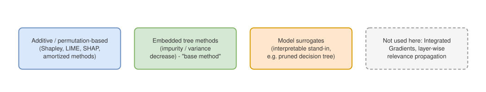

A production model we work with is a gradient-boosted tree ensemble (and,
in places, a neural net) trained on hundreds of features. Two questions
come up constantly: *why* did this specific prediction come out the way it
did, and *which* features are actually pulling weight versus just adding
variance? Answering either one well means picking the right
feature-importance method — and the landscape here is wider, and more
fragile, than "just use SHAP" suggests.

Embedded tree-based feature importance is highly sensitive to
hyperparameter choices, so it's not something we can debug with or report
to a client. Shapley values are the theoretically clean alternative, and
this post is a tour of that family — SHAP itself, and what's been built on
top of it. Two problems keep surfacing as the real obstacles, though, and
they show up together on a model like ours: classic SHAP doesn't scale
past a couple dozen features, and it gets actively unreliable once
features are highly correlated, which many of ours are (a family of
rolling time-window aggregates of the same underlying signal, for example
— 1-hour, 24-hour, and 7-day versions of it). Both problems compound:
correlated features are exactly the ones exact Shapley struggles to price
sensibly.

This post works through the landscape: the families of feature-importance
methods and where SHAP sits among them, why exact SHAP is intractable at
scale, one amortized method that gets per-sample explanations back to a
single forward pass, a hybrid that only pays the expensive price when it
needs to, and two different ways of handling correlated features — one
that keeps per-feature detail, one that gives it up for something more
stable.

## Where feature importance methods live

Modern feature-importance methods fall into a few families. This post is
about the first and third; the second is our current (unreliable) baseline.

::: {.column-page}
{#fig-families}
:::

Two more families exist but don't apply here: **Integrated Gradients**
needs a differentiable model with respect to its inputs, and **LRP**
(layer-wise relevance propagation) is neural-network-specific. Both are
out for the tree-ensemble side of the model.

## Shapley values, and why exact SHAP doesn't scale

SHAP values are simultaneously an approximation of the classic Shapley
value from cooperative game theory and a generalization of several other
attribution methods, including LIME [@lundberg2017]. For a fixed sample
$x$, the Shapley value for feature $i$ averages that feature's marginal
contribution across every possible subset of the other features:

$$
\varphi_i = \sum_{S \subseteq F \setminus \{i\}} \frac{|S|!\,(|F|-|S|-1)!}{|F|!}
\Big[ f_{S \cup \{i\}}(x_{S \cup \{i\}}) - f_S(x_S) \Big]
$$

In words: look at every permutation of features, with and without feature
$i$, and average how much adding it changes the prediction. That sum has
$2^{|F|-1}$ terms — exponential in the number of features — and in its
purest form requires retraining the model on every feature subset. With
hundreds of features, this is not "slow," it's simply not computable.

Sampling-based estimators avoid retraining by Monte Carlo sampling
permutations instead of enumerating them, and by *integrating out* missing
features (averaging the prediction over background samples) instead of
retraining without them [@aas2019]. This is what makes SHAP practical at
all — but it's still fundamentally doing many model evaluations per sample,
and it is known to become unreliable when features are substantially
correlated. Faster SHAP variants exist — model-agnostic Kernel SHAP and
model-specific Tree SHAP — but they trade one cost for another: Tree SHAP
avoids the sampling problem via recursive tree traversal, at a memory cost
of $O(TD^2 + TN)$ for an ensemble of $T$ trees of average depth $D$ with $N$
total tree nodes [@lundberg2018]. For a large ensemble, that adds up fast.

## Cutting the per-sample cost: FastSHAP

The most efficient class of methods sidesteps per-sample computation
entirely by *amortizing* it: train a parametric function once, up front,
that maps any input directly to its Shapley values in a single forward
pass. The current state of the art here is **FastSHAP** [@jethani2021].

::: {.column-page}
{#fig-fastshap}
:::

@fig-fastshap shows the shift. FastSHAP trains two surrogates instead of
running Monte Carlo sampling per sample:

1. **A surrogate for the value function itself.** Rather than solving a
   separate optimization problem per feature per sample, it learns the
   Shapley value function across many training points at once, using
   similar samples to interpolate and extrapolate — an explicit sample-
   efficiency trade.
2. **A surrogate for "what happens with missing features."** Instead of
   averaging the prediction over many background samples per subset (the
   expensive part of classic SHAP), it needs a single prediction per
   evaluation. The explanation it produces reflects the model's
   *information* dependence on a feature rather than its raw algebraic
   dependence.

The catch: once trained, FastSHAP can't guarantee accuracy for any single
feature the way a heavy Monte Carlo estimate can. It's a real trade of
per-feature guarantees for tractability.

## Paying for accuracy only where it's needed: Selective Explanations

**Selective Explanations** [@paes2024] is a hybrid: use the fast amortized
estimate where it's already trustworthy, and fall back to the slow but
accurate Monte Carlo estimate everywhere else.

$$
\text{SE}(x, y) \;\triangleq\;
\begin{cases}
\text{Amor}(x, y) & \text{if } \tau_\alpha(x) = 1, \\[4pt]
\lambda_h(x)\,\text{Amor}(x, y) + \big(1 - \lambda_h(x)\big)\,\text{MC}^n(x, y) & \text{if } \tau_\alpha(x) = 0,
\end{cases}
$$

where $\tau_\alpha$ is a threshold on an *uncertainty* measure and
$\lambda_h$ is a feature-specific blending weight. Two ways of defining
that uncertainty are proposed:

**Deep uncertainty** — train several amortized networks with different
random seeds and treat their disagreement as the uncertainty signal:

$$
s_h^{\text{Deep}}(x) \;\triangleq\; \frac{1}{dk}\sum_{i=1}^{d}
\mathrm{Var}\Big(\text{Amor}^1(x)_i, \dots, \text{Amor}^k(x)_i\Big)
$$

**Learned uncertainty** — instead of an ensemble, train a function to
directly predict the expected gap between the amortized and Monte Carlo
estimates:

$$
s_h^{\text{Learn}} \in \operatorname*{argmin}_{s \in \mathcal{F}}
\sum_{(x,y) \in \mathcal{D}_{\text{train}}}
\big| s(x) - \ell\big(\text{Amor}(x;y), \text{MC}^n(x;y)\big) \big|^2
$$

This is the most intricate of the methods here — it needs both an
uncertainty estimator and a calibrated threshold — but it's the only one
that explicitly spends the expensive computation only where the cheap one
is already known to be untrustworthy.

## The multicollinearity problem

None of the above fixes the second problem: when features are highly
correlated — a family of rolling time-window features being the clearest
example — their
joint contribution to a prediction gets *split* across all of them by the
Shapley averaging process. Each individual value ends up small and close
to arbitrary, even though the group of features clearly matters. There are
two genuinely different ways to respond to this.

### Option A: decorrelate, then attribute per feature

@basu2020 proposes removing the correlated component from every *other*
feature before estimating a given feature's importance. To remove feature
$j$'s component from feature $k$,
solve for a correction term $AF_k$ that makes the two uncorrelated:

$$
\operatorname{cor}(X_j, X_k + AF_k) = 0
\quad\Longrightarrow\quad
AF_k = -\frac{\operatorname{cov}(X_j, X_k)}{\operatorname{var}(X_j)} X_j
$$

The same idea extends to decorrelating from two features $X_i, X_j$ at
once:

$$
a = \frac{\operatorname{cov}(X_i,X_k)\operatorname{var}(X_j) - \operatorname{cov}(X_j,X_k)\operatorname{cov}(X_i,X_j)}
{\operatorname{var}(X_i)\operatorname{var}(X_j) - \operatorname{cov}(X_i,X_j)^2},
\qquad
b = \frac{\operatorname{cov}(X_j,X_k)\operatorname{var}(X_i) - \operatorname{cov}(X_i,X_k)\operatorname{cov}(X_i,X_j)}
{\operatorname{var}(X_i)\operatorname{var}(X_j) - \operatorname{cov}(X_i,X_j)^2}
$$

with $AF_k = aX_i + bX_j$. The trade-off is that the resulting values lose
the *additivity* property — correlated features no longer cleanly split
predictive credit between each other — in exchange for values that don't
bounce around randomly among correlated features from run to run. It also
gives us a diagnostic for free: comparing a pair of features' corrected
marginal importances against their corrected *joint* importance tells us
how independent they really are —

$$
\frac{\text{Multcol\_}\varphi(A) + \text{Multcol\_}\varphi(B)}{\text{Multcol\_}\varphi(A,B)}
$$

— a ratio of 1 means fully independent; the further from 1, the more
correlated.

### Option B: don't split the credit at all

**groupShapley** [@jullum2021] takes the opposite approach: instead of
correcting individual features, compute Shapley values for *groups* of
features directly, by applying the same game-theoretic formula to groups
instead of single features:

$$
\varphi_{\mathcal{G}_i} = \sum_{\mathcal{T} \subseteq \mathcal{G} \setminus \mathcal{G}_i}
\frac{|\mathcal{T}|_g!\,(G - |\mathcal{T}|_g - 1)!}{G!}
\Big(v(\mathcal{T} \cup \mathcal{G}_i) - v(\mathcal{T})\Big)
$$

where $\mathcal{G} = \{\mathcal{G}_1, \dots, \mathcal{G}_G\}$ is a
partition of the features into $G$ groups. Because this is still exactly
the Shapley framework — just applied to groups instead of individual
features — it keeps every one of the usual guarantees (efficiency,
symmetry, the null-player property) that Option A gives up. It's also
dramatically cheaper: complexity drops from $2^{|F|-1}$ to $2^{G-1}$. With
50 features collapsed into 5 groups, that's a reduction factor over
$10^{13}$.

::: {.column-page}
{#fig-groupshapley}
:::

@fig-groupshapley shows the contrast for a rolling-window feature family
specifically. Groups can be built two ways: by *practical* meaning (e.g.
all rolling-window aggregates as one group, all categorical encodings as
another) or by *statistical dependence* (cluster whatever is actually
correlated, whether or not it shares a name). For a case like this, the
natural first cut is the practical one — group the rolling-window family
together — with dependence-based grouping as a refinement if any group
still turns out to mix loosely related features.

Options A and B aren't mutually exclusive, and they answer different
questions. groupShapley tells us whether the *rolling-window family as a
whole* matters, cheaply and with all of Shapley's usual guarantees, but not
which window (1h vs. 24h vs. 7d) is carrying that signal. The AF-correction
approach can still tell us that — at the cost of the additivity property
and a more involved implementation, since off-the-shelf FastSHAP isn't
built to decorrelate before attributing. In practice, groupShapley is the
cheaper first thing to try; individual-feature decorrelation only if a
group turns out to matter and we need to know which member drives it.

## A different lever: surrogate models

Every method above stays inside the Shapley framework. A structurally
different option is to train a simpler, more interpretable model that
mimics the black-box one closely enough to *stand in* for it — most
commonly a decision tree. **Genetic decision trees** [@kennedy2022] make
this more viable than a single greedily-grown tree: a population of
candidate trees is generated with bootstrap sampling, then evolved by
mutating and combining the strongest candidates over several rounds
instead of growing one tree greedily start-to-finish. The result is a
single tree that's denser and more stable while staying close in
performance to the original ensemble. It's a fundamentally different kind
of explanation — a whole visualizable decision path instead of a
per-feature number — worth keeping in mind as a complement to
Shapley-based methods, not a replacement.

(Worth flagging: the source notes for this post linked "Genetic Decision
Trees" to arXiv:1904.12847, but that paper is actually *Optimal Sparse
Decision Trees* [@hu2019] — a different, dynamic-programming-based method
for building small trees, not the bootstrapped/evolved approach described
above. The bootstrapped-and-mutated technique matches @kennedy2022
instead, which isn't a formal paper — worth keeping in mind if this needs
a peer-reviewed citation later.)

## Where this leaves us

FastSHAP is the easiest of these to adopt now — the library applies to our
data with relatively little friction. groupShapley is nearly as cheap: it
only requires deciding on a grouping, not touching FastSHAP's internals.
Combining FastSHAP *with* per-feature multicollinearity correction is more
involved, since the correction changes what each surrogate needs to learn.
Selective Explanations is the most work of all — it needs both an
uncertainty estimator and calibrated thresholds — but it's also the only
approach here that spends the expensive computation only where it's
actually earned.

## References

::: {#refs}
:::
